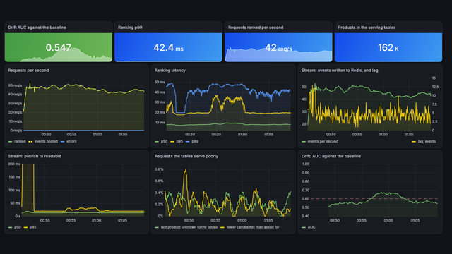
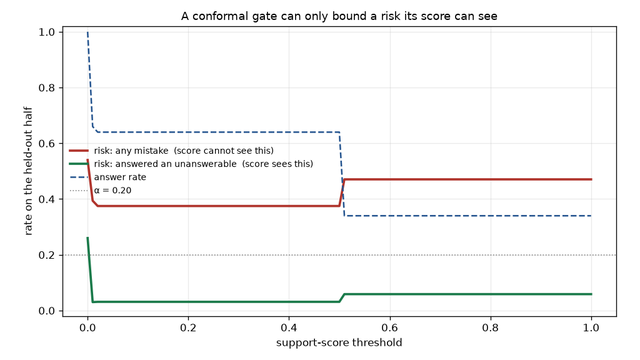
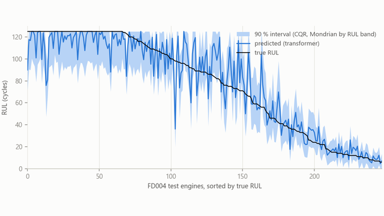
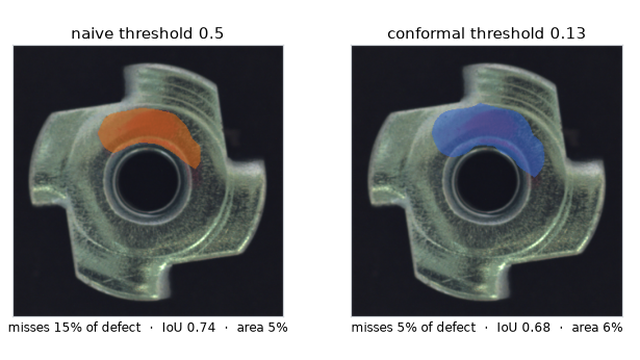
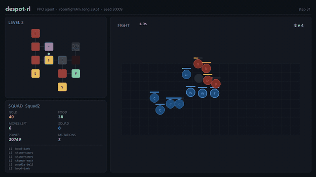

I'm finishing an MSc in Data Science at the University of Aveiro, where I'm also a research fellow on an EU-cofunded industrial project. My thesis is a machine learning system for quoting injection moulds, built with an automotive mould maker.

I'm looking for a machine learning engineering role starting in January 2027. My main projects are below; four of them have a live API you can call.

## Projects

<table>
<tr>
<td width="330" valign="top"></td>
<td valign="top">
<h3><a href="https://github.com/mateus-aleixo/marketplace-recs">marketplace-recs</a></h3>

Real-time next-product recommendations on 42M marketplace events, with co-visitation candidates and a LightGBM ranker. Recall@20 is 0.495 against 0.442 for item-to-item on a later week, and the API answers in 2.6 ms p50 on one vCPU.

Python · Polars · LightGBM · FastAPI · Kafka API · Airflow · BigQuery · GKE · Terraform 
<a href="https://github.com/mateus-aleixo/marketplace-recs">Code</a> · <a href="https://recs-api-s3kndyc7za-ew.a.run.app/docs">Live API</a>

</td>
</tr>
<tr>
<td width="330" valign="top"></td>
<td valign="top">
<h3><a href="https://github.com/mateus-aleixo/maintenance-qa-agent">maintenance-qa-agent</a></h3>

Question answering over industrial maintenance manuals that declines what it cannot answer, with hybrid BM25 and dense retrieval, Qwen2.5 generators and a tool-using agent built without a framework. A conformal gate cut answers to unanswerable questions from 26% to 3.1% while still answering 64% of questions.

Python · FAISS · ONNX Runtime · SQLite FTS5 · FastAPI · AWS Lambda · Terraform 
<a href="https://github.com/mateus-aleixo/maintenance-qa-agent">Code</a> · <a href="https://245evfkghe.execute-api.eu-west-1.amazonaws.com/docs">Live API</a>

</td>
</tr>
<tr>
<td width="330" valign="top"></td>
<td valign="top">
<h3><a href="https://github.com/mateus-aleixo/turbofan-rul">turbofan-rul</a></h3>

Remaining useful life prediction for turbofan engines (NASA C-MAPSS), with transformer and LSTM models trained from scratch in PyTorch and a conformal interval on every prediction. The intervals cover 87–89% at a 90% target, and a LightGBM baseline won 3 of the 4 subsets.

PyTorch · LightGBM · ONNX Runtime · FastAPI · AWS Lambda · Terraform · Helm 
<a href="https://github.com/mateus-aleixo/turbofan-rul">Code</a> · <a href="https://aao1ufi805.execute-api.eu-west-1.amazonaws.com/docs">Live API</a>

</td>
</tr>
<tr>
<td width="330" valign="top"></td>
<td valign="top">
<h3><a href="https://github.com/mateus-aleixo/defect-segmentation">defect-segmentation</a></h3>

Defect segmentation on five MVTec AD categories with a fine-tuned DeepLabV3, its mask threshold set by conformal risk control to bound the missed-defect rate. Switching the calibration loss from missed defect pixels to missed defect instances cut false alarms on clean parts in every category with signal, on leather from 34% to 6.2%.

PyTorch · torchvision · OpenCV · ONNX Runtime · AWS Lambda · Terraform 
<a href="https://github.com/mateus-aleixo/defect-segmentation">Code</a> · <a href="https://6s8ozlsit4.execute-api.eu-west-1.amazonaws.com/docs">Live API</a>

</td>
</tr>
<tr>
<td width="330" valign="top"></td>
<td valign="top">
<h3><a href="https://github.com/mateus-aleixo/despot-rl">despot-rl</a></h3>

A simulator of Despot's Game built from the game's own data tables, with hierarchical PPO agents trained on it. The battle loop runs in a Rust library behind a C ABI, 142x faster per fight than the Python reference, with its random number generator matching CPython's bit for bit.

Python · PyTorch · Gymnasium · Rust 
<a href="https://github.com/mateus-aleixo/despot-rl">Code</a>

</td>
</tr>
</table>

## Papers and talks

- M. Aleixo and E. Rocha, *A Hybrid Soft-Computing Decision-Support System for Injection-Mould Quotation*, CONTROLO 2026, Coimbra, Portugal. Peer-reviewed and presented; IEEE Xplore, to appear.
- M. Aleixo and E. Rocha, *A Machine Learning System for Manufacturing Time Estimation in Injection Mold Production*, talk at DII 2026.

You can reach me on [LinkedIn](https://www.linkedin.com/in/mateus-aleixo/).
